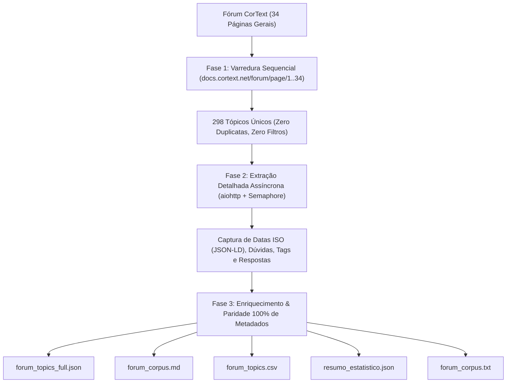

# Análise de Fricção em Data Parsing: Evidências Estatísticas do Fórum CorText (TCC UFBA)

Este repositório contém a infraestrutura de extração, consolidação de dados e dashboard analítico do Trabalho de Conclusão de Curso (TCC) na **Universidade Federal da Bahia (UFBA)**.

O objetivo da pesquisa é fundamentar, desenvolver e avaliar um **Assistente de Observabilidade Sociotécnica** baseado em **Qualidade de Dados (*Data Profiling*)** e **Recuperação Aumentada por Geração (*RAG*)**, voltado a mitigar atritos e falhas na etapa de preparação de dados (*Data Parsing*) na plataforma **CorText Manager**.

---

## 📌 Contexto da Pesquisa

O **CorText Manager** é uma plataforma digital com mais de 15 anos de história, amplamente utilizada por pesquisadores das Ciências Sociais e Humanidades para processamento e análise de corpora textuais heterogêneos. 

Embora o ecossistema ofereça heurísticas avançadas de parsing e flexibilidade de parâmetros, a extrema heterogeneidade das bases brutas (como *Scopus*, *Web of Science*, *Factiva*, formatos tabulares governamentais e mídias sociais) faz com que a etapa inicial de **Data Parsing** represente o maior ponto de fricção técnica e cognitiva para os usuários. 

Para demonstrar empiricamente essa necessidade, foi realizada uma varredura completa, estruturada e auditável do **fórum oficial da plataforma** (`https://docs.cortext.net/forum/`).

---

## 🚀 Engenharia da Extração (`extract_forum.py`)

O extrator ([extract_forum.py](extract_forum.py)) foi construído com uma abordagem determinística e pragmática dividida em três fases:



### Fase 1: Varredura Sequencial da Paginação Oficial
* Itera estritamente pela listagem geral: `https://docs.cortext.net/forum/page/1/` até `page/34/`.
* **Sem filtros aplicados**: captura todos os tópicos sem distinção de status ou autor.
* **Cobertura Total**: Páginas 1 a 33 (9 tópicos cada) + Página 34 (1 tópico) = **Exatamente 298 tópicos únicos** (0 duplicatas, 0 omissões).

### Fase 2: Extração Profunda dos Tópicos (Assíncrona)
* Utiliza `aiohttp` com semáforo de concorrência (`--concurrency 6`) e retries automáticos com barra de progresso (`tqdm`).
* **Datas Exatas em ISO 8601**: Extrai `datePublished` e `dateModified` diretamente das marcações semânticas JSON-LD Schema do WordPress.
* **Decomposição das Respostas**: Extrai separadamente cada resposta, autor, links de perfil, contagem de votos, melhor resposta e identifica automaticamente respostas oficiais da equipe (`🛡️ Staff do CorText`).

### Fase 3: Enriquecimento e Paridade Total de Dados
* Todas as informações extraídas e variáveis derivadas (`is_resolved`, `is_answered`, `first_answer_author`, `answers_authors`, `question_length_words`, etc.) são consolidadas em todos os formatos de saída simultaneamente.

---

## 📂 Estrutura de Arquivos da Pasta `output_forum/`

Todos os dados consolidados estão organizados na pasta [`output_forum/`](output_forum/):

| Arquivo | Formato | Descrição e Finalidade |
| :--- | :---: | :--- |
| **`forum_topics_full.json`** | JSON | **Base mãe completa**. Contém todos os 298 tópicos com seus metadados completos e o array hierárquico de respostas aninhadas. É o arquivo consumido pelo dashboard do Streamlit. |
| **`forum_corpus.md`** | Markdown | **Corpus textual formatado para leitura humana e análise qualitativa**. Possui tabelas de metadados com links clicáveis (autor, categoria, URL original), selos de status (🟢/🟡/⚪), extensão textual, dúvidas na íntegra e todas as 363 respostas completas com badges de Staff. |
| **`forum_topics.csv`** | CSV (`UTF-8-SIG`) | **Dataset tabular estruturado** para análise quantitativa em Excel, R, Pandas ou SPSS. Contém 25 colunas analíticas por linha. |
| **`resumo_estatistico.json`** | JSON | Resumo computado com métricas descritivas: total de tópicos, taxa de resposta geral (86,91%), taxa de atendimento pelo Staff (78,19%), distribuição de categorias e o ranking **Top 10 mais visualizadas**. |
| **`forum_corpus.txt`** | TXT | Versão textual plana e unificada das discussões do fórum. |

---

## 📖 Dicionário de Dados Completo

| Campo | Tipo | Descrição |
| :--- | :---: | :--- |
| `id` | Inteiro | Identificador sequencial único do tópico (1 a 298) |
| `page` | Inteiro | Página de origem na paginação do fórum (1 a 34) |
| `title` | Texto | Título da dúvida postada |
| `url` | Link | URL permanente original da discussão |
| `status` | Texto | Status oficial (*Open*, *Answered*, *Resolved*, *Closed*, *Pending*) |
| `is_resolved` | Booleano | Indicador se o tópico foi formalmente resolvido |
| `is_answered` | Booleano | Indicador se o tópico recebeu respostas |
| `category` | Texto | Categoria metodológica no CorText |
| `category_url` | Link | URL da categoria no fórum |
| `author_name` | Texto | Nome de exibição do autor da dúvida |
| `author_user` | Texto | Slug técnico do autor no sistema |
| `author_url` | Link | URL do perfil do autor |
| `time_ago` | Texto | Tempo relativo registrado na postagem (ex: *asked 5 months ago*) |
| `date_published` | ISO 8601 | Data e hora exatas de criação do tópico (via JSON-LD) |
| `date_modified` | ISO 8601 | Data e hora da última modificação |
| `views_count` | Inteiro | Contador público acumulado de visualizações da página |
| `answers_count` | Inteiro | Número total de respostas registradas |
| `votes_count` | Inteiro | Saldo de votos (upvotes - downvotes) da pergunta |
| `question_length_chars` | Inteiro | Quantidade total de caracteres no corpo da pergunta |
| `question_length_words` | Inteiro | Quantidade total de palavras no corpo da pergunta |
| `tags` | Lista / Texto | Palavras-chave associadas à dúvida |
| `has_staff_answer` | Booleano | Indica se a equipe técnica do CorText respondeu ao chamado |
| `first_answer_author` | Texto | Autor da primeira resposta registrada |
| `answers_authors` | Lista / Texto | Todos os autores que responderam ao tópico |
| `question_body` | Texto | Conteúdo integral da pergunta formulada pelo pesquisador |
| `answers` *(JSON/MD)* | Array | Respostas completas com texto, autor, votos, datas e badges |

---

## 📊 Principais Evidências Empíricas Encontradas

1. **Gargalo Absoluto em Preparação de Dados**:
   * A categoria oficial **`Data processing` lidera o fórum com 84 tópicos (28,2%)**, superando as etapas substantivas de análise (*Network mapping* com 26,5% e *Text processing* com 17,1%).
   * Ao analisar os problemas derivados (falhas em outras etapas decorrentes de corpus mal formatado, delimitadores, indexadores ou formatos heterogêneos), **198 tópicos (66,4% de todo o fórum)** envolvem direta (**84 tópicos** em *Data processing*) ou indiretamente (**114 tópicos derivados**) problemas de Data Parsing.
   * Os **114 tópicos derivados** foram mapeados sob 3 critérios analíticos: (1) Manipulação de Formato Bruto Heterogêneo (62 tópicos); (2) Menção Explícita de Indexação/Parsing/Encoding em Outras Etapas (50 tópicos); e (3) Sintomas Patognomônicos de Corpus Corrompido/Vazio (2 tópicos).
2. **Dependência Crônica da Equipe Técnica (*Staff as Human Parser*)**:
   * **81,0% dos tópicos de Data Processing** exigiram intervenção manual dos desenvolvedores do CorText para depuração e inspeção de logs nos servidores.
3. **Mapeamento da Fricção por Formato de Entrada**:
   * Os maiores focos de atrito são **CSV / delimitadores (29,8%)**, **arquivos ZIP (28,6%)**, **Web of Science / WOS (22,6%)**, **Scopus (13,1%)** e **RIS (13,1%)**.
4. **Volume de Tráfego Orgânico**:
   * O fórum acumula **791.665 visualizações** (com mediana de 2.216 views por tópico), demonstrando que as mesmas dúvidas de parsing são consultadas por milhares de pesquisadores ao longo dos anos.

---

## 🖥️ Dashboard Sociotécnico em Streamlit (`dashboard_tcc.py`)

O repositório inclui um dashboard analítico interativo construído em **Streamlit** e **Plotly**, projetado especificamente para apresentar essas evidências:

### Como Executar o Dashboard:
```powershell
.\env\Scripts\python -m streamlit run dashboard_tcc.py
```
Acesse no navegador em: **`http://localhost:8501`**

### Abas Disponíveis no Dashboard:
1. **📊 1. Data Parsing Expandido**: Gráfico de rosca da decomposição de parsing (84 diretos vs 114 derivados), distribuição de parsing por categoria, auditoria de views (volume total vs mediana) e a **Nota Metodológica Detalhada dos 114 Tópicos Derivados**.
2. **📁 2. Mapeamento da Fricção por Formato de Entrada**: Ranking horizontal de formatos problemáticos (CSV, ZIP, WOS, Scopus, RIS, Factiva).
3. **🔍 3. Opacidade & Dependência do Staff**: Comparativo de intervenção do Staff e dispersão textual (boxplot de palavras).
4. **⏳ 4. Persistência Temporal**: Evolução das discussões ano a ano de 2014 a 2026.
5. **🔎 5. Central de Consulta dos Tópicos**: Mecanismo centralizado de consulta com busca livre por palavras-chave e filtros por categoria, escopo de parsing (direto, derivado ou subcritérios), formato bruto e intervenção do Staff.

---

## 🗂️ Estrutura Limpa do Repositório

```text
crawl4ai/
│
├── env/                      # Ambiente virtual Python com dependências instaladas
├── output_forum/             # Base de dados oficial consolidada (100% paridade)
│   ├── forum_topics_full.json
│   ├── forum_corpus.md
│   ├── forum_topics.csv
│   ├── resumo_estatistico.json
│   └── forum_corpus.txt
│
├── dashboard_tcc.py          # Aplicação interativa em Streamlit
├── extract_forum.py          # Extrator determinístico e gerador de datasets
├── requirements.txt          # Dependências do projeto (streamlit, plotly, pandas, etc.)
└── README.md                 # Documentação completa do processo
```

---

## 🔄 Como Reproduzir a Extração do Zero

Caso seja necessário atualizar a base no futuro com novos tópicos postados no fórum:

```powershell
# Execução completa com extração profunda (todas as 34 páginas)
.\env\Scripts\python extract_forum.py --concurrency 6

# Execução rápida apenas dos metadados da listagem
.\env\Scripts\python extract_forum.py --no-details
```
